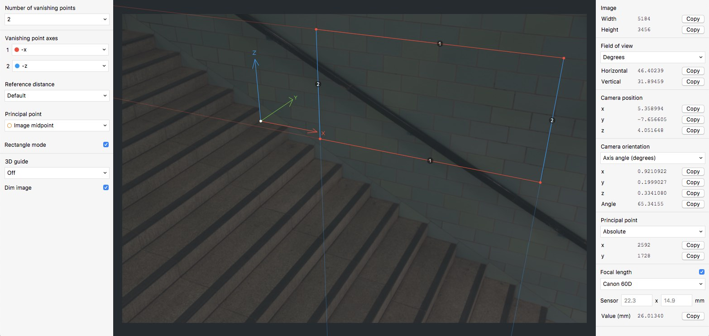
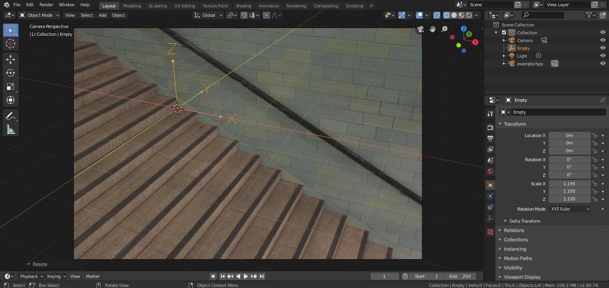
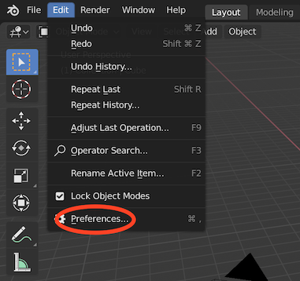
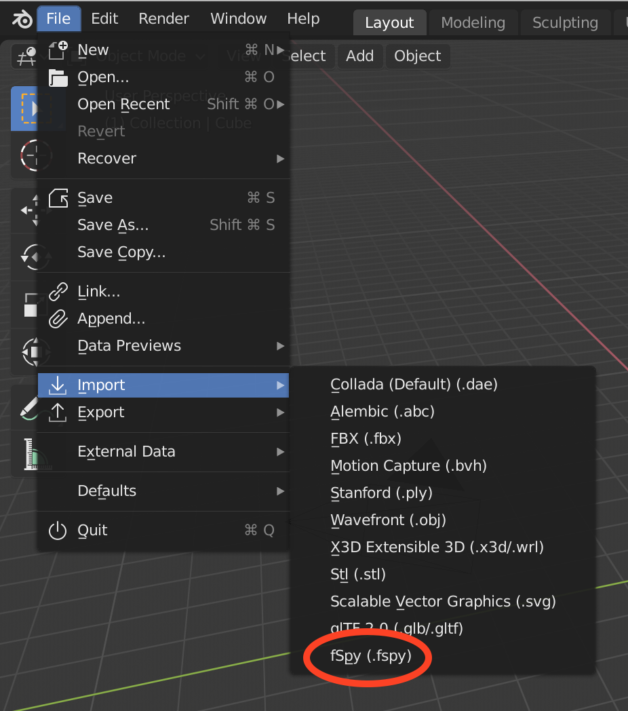
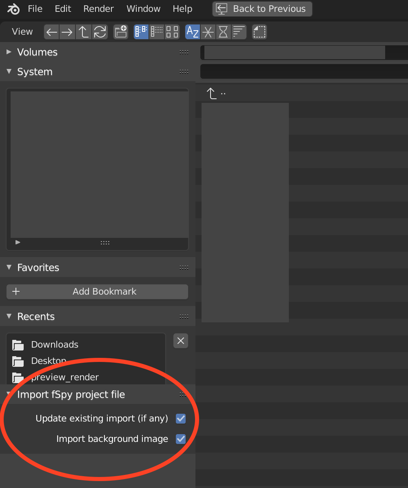

# What is this?

This is the official [fSpy](https://fspy.io) importer add-on for [Blender](https://blender.org). The two images below show an fSpy project (top) and a matching Blender camera created by the importer (bottom).

# Getting started

## 1. Download the add-on

[Download the latest version](https://github.com/stuffmatic/fSpy-Blender/releases/latest) (make sure you download the file called `fSpy-Blender-x.y.z.zip`).

### ⚠️ __Important note for mac users__ ⚠️

If you're using Safari, make sure you __download the add-on by right clicking and choosing "Download Linked File"__. This prevents the downloaded file from getting unzipped automatically.

## 2. Install the add-on

This version of the add-on is packaged as a Blender extension and supports __Blender 4.2 and newer__, including Blender 4.5 LTS and the 5.x series (up to and including 5.2 LTS).

> ⚠️ If you have an older version of the fSpy importer installed as a legacy add-on, remove it before installing this one.

The easiest way to install is to __drag and drop the downloaded zip file into the Blender window__ and confirm the installation in the dialog that appears.

Alternatively, install it manually:

1. Open the preferences window by selecting Preferences from the Edit menu

   

2. Select the _Get Extensions_ tab, open the dropdown menu in the top right corner and choose _Install from Disk..._

3. Select the downloaded zip file

The add-on is enabled automatically after installation. You can find it in the _Add-ons_ tab of the preferences window.

## 3. Import an fSpy project file

Once the add-on is installed and activated, fSpy project files can be imported by selecting _fSpy_ from the _Import_ menu. This will create a camera with the same name as the imported project file.

### Import settings

At the bottom left in the importer's file browser, there is a panel with import settings.

__Update existing import (if any)__ - If checked, any previously created camera with a name matching the project filename will be updated. If unchecked, a new camera will be created on each import. 

__Import background image__ - If checked, the image from the fSpy project file will be used as the background image for the Blender camera.

# Support for older Blender versions

* __Blender 2.80 – 4.1__: use [version 1.0.3](https://github.com/stuffmatic/fSpy-Blender/releases/tag/v1.0.3) of the add-on, installed as a legacy add-on.
* __Blender versions older than 2.80__: use [version 1.0.2](https://github.com/stuffmatic/fSpy-Blender/releases/tag/v1.0.2) of the add-on.
